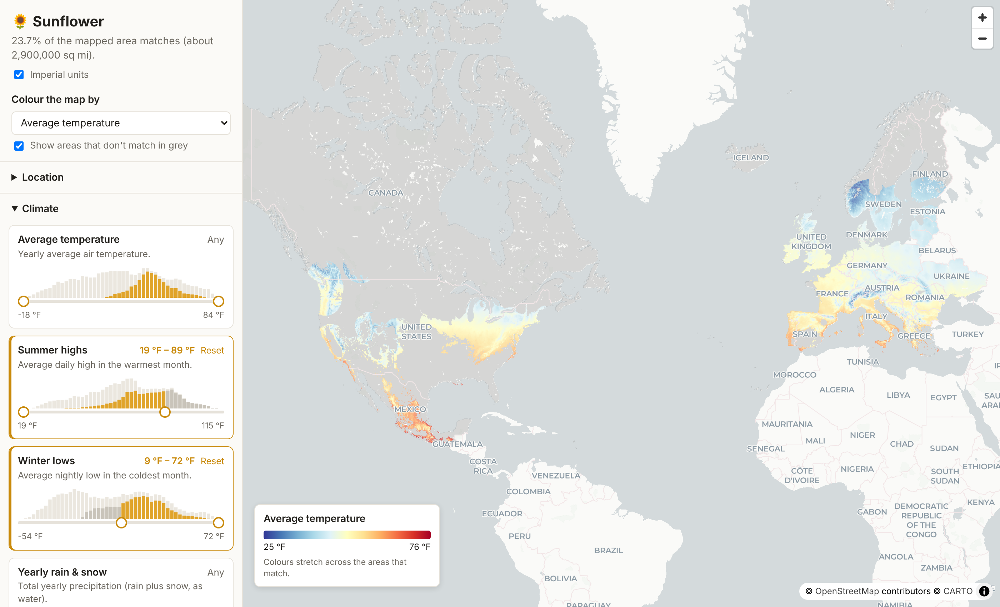

# 🌻 Sunflower

A small map dashboard for answering "where could we live?". Set hard filters on
climate and geography (yearly temperature, winter lows, rainfall, distance to the
ocean, distance to a big city, country…), and the map shows which places pass,
coloured by any variable you choose.



Currently covers the **US, Canada, Mexico and Europe** on a ~9 km grid.

## How it works

```
raw datasets ──► pipeline/build.py ──► web/public/data/*.bin.gz + catalog.json ──► web app (static)
 (WorldClim,      resample everything      one compact array per layer,             filters + colours
  Natural Earth)  onto ONE shared grid     all cells aligned                         in the browser
```

* **One grid for everything.** Every layer is resampled to the same 5-arc-minute
  lat/lon grid (≈9 km cells, aligned with WorldClim). A layer is then just an
  array with one value per cell, so filtering is a fast loop over a few arrays
  and adding a layer never touches the app's core logic.
* **Filters** are ranges: a cell matches if it passes every filter that's set.
  A filter left at its full range ("Any") does nothing.
* **Histograms** on each slider show how values are spread. The pale bars cover the
  whole region. The coloured bars count only places that pass *all the other*
  filters, so you can see what loosening this one would gain.
* **"Distance to a major city"** is computed four times, for cities of 100k, 300k,
  500k and 1M+ people. The buttons on that filter switch between them instantly.
* **No server.** The app is static files, about 5 MB of data in total, so it runs from
  `npm run dev` locally or from GitHub Pages.

## Running locally

```bash
cd web
npm install
npm run dev        # open the printed URL
```

The processed data is committed in `web/public/data/`, so you only need the
pipeline when adding or changing layers.

## Rebuilding the data

```bash
python3 -m venv .venv
.venv/bin/pip install -r pipeline/requirements.txt
pipeline/download.sh             # ~200 MB into data/raw (git-ignored)
.venv/bin/python pipeline/build.py
```

To add a layer: get its source onto the grid in `build.py` (`read_worldclim`
shows how for any raster; `distance_to_points_km` shows how for point data),
then pass it through `numeric_layer(...)` and add an entry to `layers`. The app
picks it up from `catalog.json` automatically.

To change the region, edit `WEST/EAST/SOUTH/NORTH` and the country lists at the
top of `build.py`.

## Publishing on GitHub Pages

GitHub Pages hosts static sites straight from a repo, which suits this app. The
workflow in `.github/workflows/pages.yml` builds the app and publishes it on every
push to `main`.

One-time setup:

1. Merge this work into `main`.
2. In the repo on GitHub go to **Settings → Pages → Build and deployment** and set
   **Source** to **GitHub Actions**.
3. Push (or run the workflow by hand from the **Actions** tab). The site appears at
   `https://<your-user>.github.io/sunflower/`.

Notes: Pages on a **private** repo needs a paid GitHub plan; on a public repo
it's free. The site is public even if you never share the link. The data is
derived from open datasets, so that's harmless here.

## Data sources

| Layer | Source | Notes |
|---|---|---|
| Country | [Natural Earth](https://www.naturalearthdata.com/) 1:10m Admin 0 | Large lakes removed |
| Average temperature, Summer highs, Winter lows, Yearly rain & snow | [WorldClim 2.1](https://www.worldclim.org/data/worldclim21.html) BIO1/5/6/12, 5′ | 1970–2000 averages |
| Distance to the ocean | Natural Earth 1:10m coastline | Straight-line (great-circle) distance |
| Distance to a major city | Natural Earth 1:10m populated places (`POP_MAX`, ≈ metro population) | Straight-line distance. Natural Earth misses some smaller cities, so the 100k+ option is the least complete. |

See [ROADMAP.md](ROADMAP.md) for planned layers.
